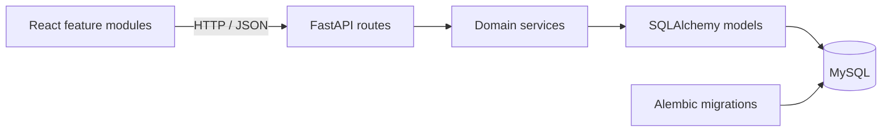

<div align="center">

# RestaurantAI

### From ingredient deliveries to dishes the kitchen can actually make.

RestaurantAI connects ingredient catalogs, dated inventory batches, recipes, and live menu availability in one restaurant operations app.

**React + TypeScript · FastAPI · MySQL**

[Explore the workflow](#the-workflow) · [See the architecture](docs/ARCHITECTURE.md) · [Run locally](#get-started)

</div>

---

## The problem

A stock total alone cannot tell a kitchen which batch expires first, whether a recipe is short on an ingredient, or how many servings are possible. RestaurantAI links those records so staff can follow inventory from intake through preparation.

## The workflow

1. Maintain ingredients and a sellable menu catalog.
2. Record received stock as supplier batches with dates and costs.
3. Define recipes and their per-serving ingredient requirements.
4. Review low-stock and expiry alerts, then see current dish capacity and its limiting ingredients.

The backend can also deduct recipe stock using FEFO (First-Expiring, First-Out), with an audit transaction for each batch movement.

## Built for restaurant operations

The current app includes ingredient, menu, recipe, inventory, availability, and live dashboard workflows. It is designed for the same day-to-day questions found in restaurants, cafes, bakeries, hotels, cloud kitchens, and catering businesses.

The underlying inventory and operations architecture is reusable: with domain-specific records and rules, it could also support retail inventory, warehouses, manufacturing, pharmacies, grocery stores, or other inventory systems. RestaurantAI is one practical implementation of that broader pattern.

## What’s inside

- **Traceable stock:** supplier batches, received and expiry dates, and inventory movement history.
- **Waste-aware preparation:** atomic FEFO consumption with FIFO tie-breaking.
- **Recipe capacity:** live availability, maximum servings, ingredient bottlenecks, and shortages.
- **Operational overview:** live catalog counts, inventory category counts, low-stock items, and expiring batches.
- **Engineering foundations:** modular REST APIs, relational constraints, Alembic migrations, typed API integration, and responsive feature-based UI.

## Technology

| API and data | Web application |
| --- | --- |
| Python, FastAPI, Pydantic | React 19, TypeScript, Vite |
| SQLAlchemy 2, Alembic, MySQL | React Router, Tailwind CSS v4 |
| REST, transactional services | Axios, TanStack Query configured |

TanStack Query is installed and provided at the app root; feature screens currently load data using local React state and effects.

## A look inside

**Screenshots:** Product screenshots are not available yet. The repository includes system and workflow diagrams in [`docs/`](docs/).



## Get started

You’ll need Python, Node.js, and MySQL. Create the database, copy `.env.example` to `.env`, and set the database credentials. From the repository root:

```bash
python -m pip install -r requirements.txt
alembic -c backend/alembic.ini upgrade head
uvicorn app.main:app --app-dir backend --reload
```

In another terminal:

```bash
npm --prefix frontend install
npm --prefix frontend run dev
```

The API defaults to `http://localhost:8000`; set `VITE_API_BASE_URL` to use another address. Interactive API reference is available at `/docs` while the API is running.

## Repository map

```text
backend/app/     API routes, services, schemas, models, and database setup
frontend/src/    Feature-based React application
docs/            Architecture, data model, API, decisions, and project history
tests/           Backend tests
```

## What this project explores

Relational modeling, API contracts, service boundaries, migration practices, typed frontend integration, auditability, and translating real inventory rules into atomic database operations.

## Next steps

The current milestone is 3.11.1: React Hook Form for shared forms. A guided production simulator, settings workflows, broader automated testing, and deployment preparation are future work. See [Future Enhancements](docs/FUTURE_ENHANCEMENTS.md).

## Documentation

- [Architecture](docs/ARCHITECTURE.md) · [Database design](docs/DATABASE_DESIGN.md) · [API design](docs/API_DESIGN.md)
- [Engineering decisions](docs/ENGINEERING_DECISIONS.md) · [Development history](docs/DEVELOPMENT_HISTORY.md) · [Future enhancements](docs/FUTURE_ENHANCEMENTS.md)

## License

No `LICENSE` file is currently included.
