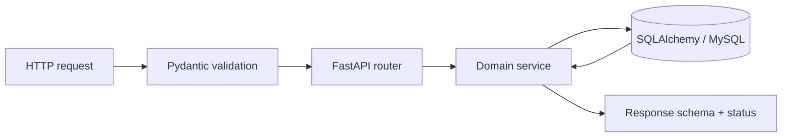

# API Design

The backend exposes a resource-oriented REST API using FastAPI. Routers group operational domains, Pydantic schemas define request and response contracts, and services coordinate domain rules and persistence. FastAPI serves the generated OpenAPI reference at `/docs`; this document describes conventions rather than duplicating every operation.

## Resource map

| Resource | Base path | Main responsibilities |
| --- | --- | --- |
| Ingredients | `/ingredients` | Ingredient catalog CRUD |
| Menu items | `/menu-items` | Sellable catalog CRUD |
| Recipes | `/recipes` | Preparation formula CRUD |
| Recipe ingredients | `/recipe-ingredients` | Recipe requirements/BOM CRUD |
| Inventory batches | `/inventory-batches` | Batch intake, listing, low-stock and expiry views |
| Inventory transactions | `/inventory-transactions` | Movement records and history reads |
| Inventory operations | `/inventory/consume` | Atomic recipe stock consumption |
| Availability | `/availability` | Recipe/menu capacity and ingredient breakdowns |
| Health | `/health` | Database connectivity check |

Most catalog resources use `GET` collection/detail, `POST` create, `PUT` update, and `DELETE`. Collection reads support `skip` and `limit`; availability caps `limit` at 500. The root route returns a welcome response.

## Contracts and validation

Pydantic validates payload types, required fields, enums, and declared field bounds before services run. Services validate rules dependent on persisted data, including foreign-key existence, duplicate relationships, and sufficient stock. SQL constraints provide a final integrity boundary. Response models define returned JSON shapes.

## Status and errors

The API uses standard HTTP status codes: `200` for successful reads/updates/deletes and operations, `201` for resource creation, `400` for invalid domain operations (including insufficient stock), `404` for missing resources, `422` for request validation failures, and `503` when the health check cannot reach the database. FastAPI validation errors include a `detail` array of issues; HTTP errors generally include a `detail` message. Clients should present validation issues as readable field messages rather than stringify the raw response object.

## Operational endpoints

- `GET /availability/recipes` and `GET /availability/menu-items` calculate paginated availability summaries in bulk. Detail routes include ingredient-level stock breakdowns.
- `POST /inventory/consume` accepts a recipe and serving count, returns deductions and remaining batch stock, and uses FEFO with FIFO receipt-date tie-breaking. Deductions and audit writes are atomic.
- `/inventory-batches/low-stock`, `/expiring`, and `/expired` provide inventory health views.
- `GET /health` checks database connectivity and returns `503` if it fails.

## Request flow

## Design notes

- Endpoints use resource paths and HTTP verbs for CRUD; explicit operation paths represent actions such as inventory consumption.
- Routers own HTTP concerns while service logic remains reusable and focused on domain behavior.
- Bulk availability endpoints fetch related records in sets and eager-load ingredient details to avoid one-query-per-row patterns.
- Availability reads are separate from inventory-consuming writes.
