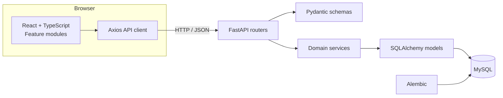
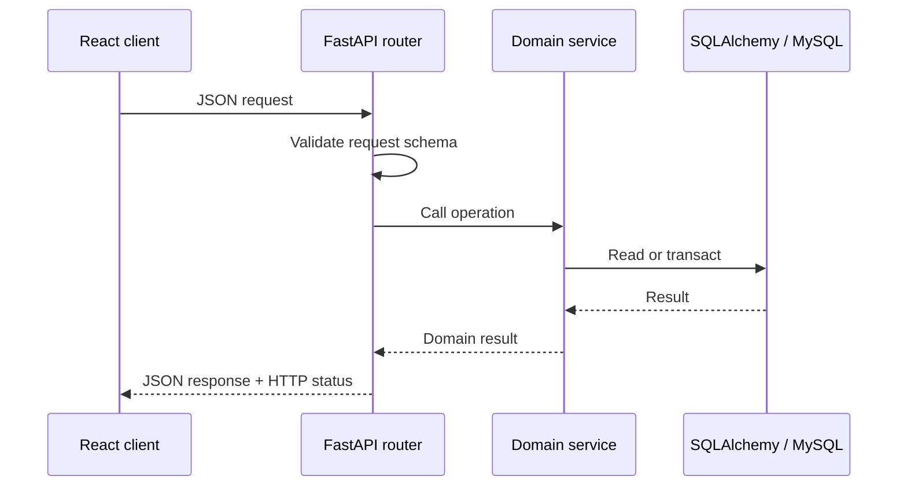

# System Architecture

RestaurantAI is a single-deployable full-stack application: a React single-page app calls a FastAPI REST API, which coordinates domain services and persists relational data through SQLAlchemy to MySQL. Alembic versions database changes.



## Backend request flow

Routers define resource paths, dependencies, HTTP status codes, and response schemas. Pydantic validates incoming and outgoing data. Service functions/classes hold business rules and coordinate database work. SQLAlchemy models map records and relationships; a request-scoped database dependency opens and closes sessions. The separation keeps HTTP concerns out of inventory rules.



## Operational boundaries

- **Inventory batches hold lot-level stock.** Batch quantities are authoritative for stock on hand; the ingredient's `current_stock` is synchronized to their aggregate for catalog and availability reads.
- **Transactions record subsequent movements.** Receipt establishes the initial batch quantity; subsequent consumption, waste, adjustment, and expiry movements are recorded as positive-quantity transaction rows.
- **Consumption is transactional.** The service validates every recipe requirement against eligible batch quantities before deductions, then writes batch updates and audit rows in one database transaction. Failure rolls back the operation.
- **Availability is a read operation.** It calculates maximum servings from ingredient stock and per-serving recipe requirements, and returns a per-ingredient breakdown without changing stock.
- **Commercial and culinary data are separate.** A menu item contains category and selling price; its optional recipe stores preparation details.

## Frontend structure

`frontend/src/features/` groups pages, components, types, and services by business area: ingredients, menu, recipes, inventory, availability, and dashboard. Shared routing and the application shell live outside feature modules. A centralized Axios client configures the API base URL and common response handling. React Router handles navigation. TanStack Query is configured at the application root, while feature pages currently use local state and effects for data loading.

## Layout at a glance

```text
backend/app/     api · services · schemas · models · core · db
backend/alembic/ versioned schema migrations
frontend/src/    api · components · features · layouts · routes
docs/            engineering and product documentation
tests/           backend tests
```

For relational entities and constraints, see [Database Design](DATABASE_DESIGN.md). For endpoint conventions, see [API Design](API_DESIGN.md).
