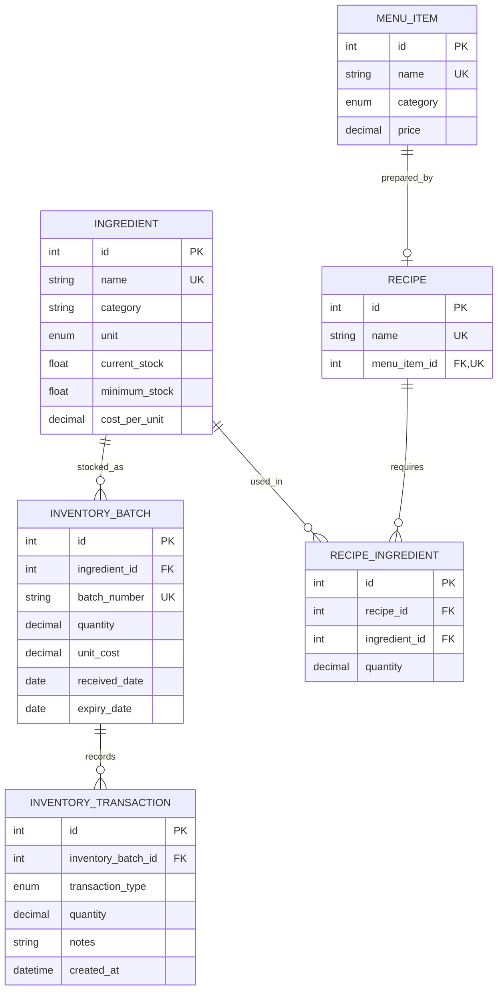

# Database Design

RestaurantAI uses MySQL and SQLAlchemy models to represent the restaurant catalog, preparation requirements, stock lots, and stock movements. Alembic migrations keep schema changes versioned. Availability is calculated from these records and is not stored separately.

## Entity relationship diagram

## Relationships and integrity

- A menu item may have zero or one recipe. `recipes.menu_item_id` is a unique foreign key; deleting the menu item cascades to its recipe.
- A recipe has many ingredient requirements. `recipe_ingredients` is an explicit association entity because the relationship carries per-serving quantity. A unique `(recipe_id, ingredient_id)` constraint prevents duplicate lines.
- An ingredient can appear in many recipe requirements and inventory batches.
- A batch belongs to one ingredient and has a unique batch number. It stores supplier, receipt and expiry dates, remaining quantity, and unit cost.
- A transaction belongs to one batch. Its positive quantity and type describe a movement (consumption, waste, adjustment, or expiry).
- Foreign keys and uniqueness are enforced in the relational schema; services also check references and business conditions such as sufficient stock.

## Modeling choices

### Normalization and aggregate stock

Catalog, recipe, requirement, batch, and transaction concerns are kept in separate tables. Recipe requirements connect recipes and ingredients while carrying quantity; batches preserve lot-level facts. Ingredient `current_stock` is synchronized to batch quantities for simpler catalog and availability reads. Batch quantities remain the detailed inventory state, so write workflows must keep the aggregate synchronized.

### Precision

Prices and modeled per-serving/lot quantities use `Numeric(10, 2)` and Python `Decimal`. Ingredient aggregate stock uses `Float`, as currently defined by the schema. Financial values avoid binary floating-point rounding.

### Indexes and constraints

Unique indexed names support catalog lookups and duplicate prevention. Batch numbers are unique and indexed. Inventory transaction batch and type columns are indexed for history queries. Recipe ownership and recipe-ingredient uniqueness enforce cardinality. A database check requires positive transaction quantities.

## Data flow: receiving, consuming, and availability

1. Receiving creates a batch with quantity and metadata, then synchronizes the ingredient aggregate.
2. Recipe requirements express amounts needed for one serving in the associated ingredient’s unit.
3. Consumption checks all requirements against eligible lots, selects batches FEFO (expiry date, then receipt date), deducts quantities, writes audit rows, and synchronizes stock in a database transaction.
4. Availability divides each ingredient stock by its per-serving requirement, rounds down to whole servings, and uses the smallest capacity as the recipe/menu item capacity. It performs no writes.

## Interview questions

- **Why a recipe requirement table?** The many-to-many link has its own quantity data, and a composite unique constraint prevents duplicate lines.
- **Why model inventory by batch?** Expiry and supplier details support traceability and FEFO selection.
- **How is stock consistency handled?** Batch quantities are detailed stock; write services update the ingredient’s synchronized total in the same workflow.
- **Why migrations?** Versioned Alembic revisions apply schema changes incrementally to existing databases.
